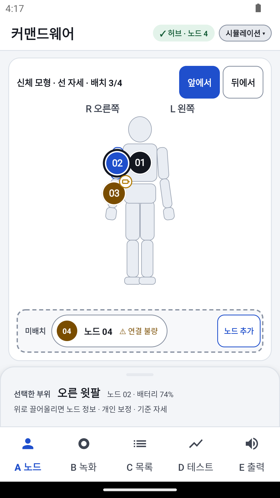
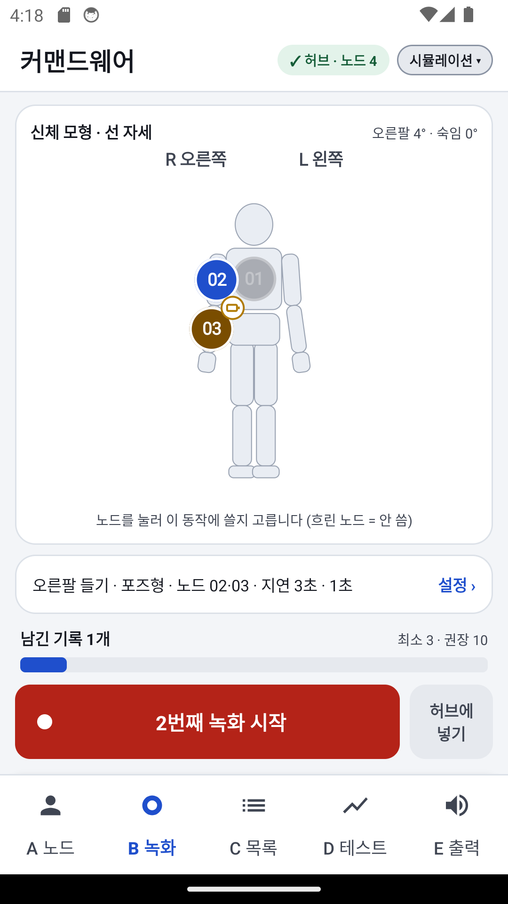
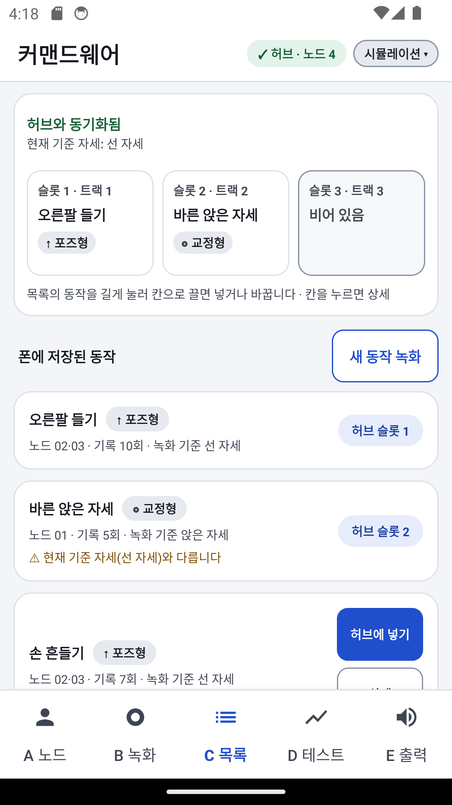
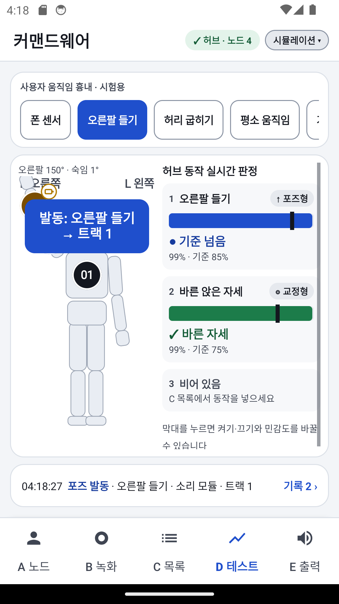
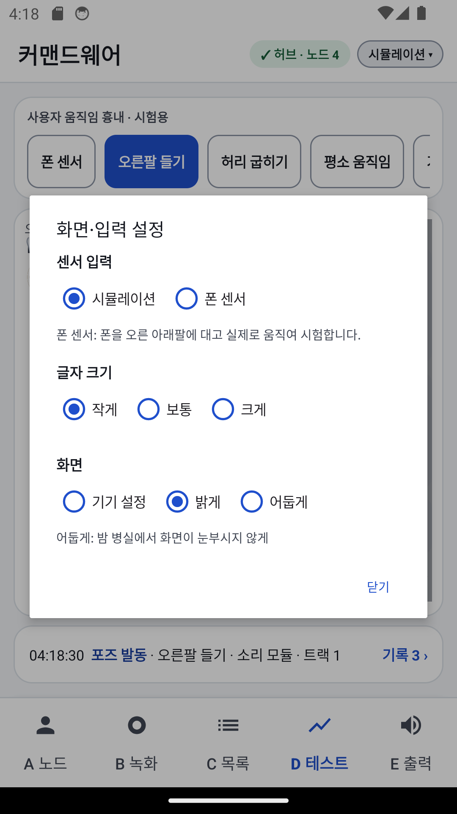
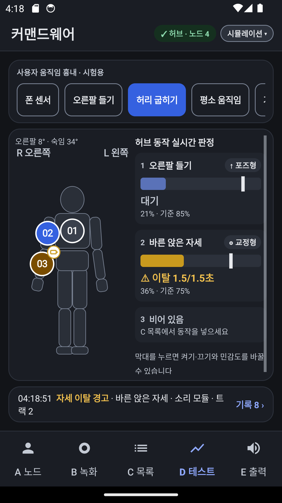

# 결과 보고서

## 2026-2 스마트디바이스프로그래밍

- 학번: 2022111772
- 이름: 서국현

## 프로젝트명: 커맨드웨어 등록 앱 — 몸의 동작을 버튼으로 만드는 보조자용 설정 앱

> 제안서(`docs/제안서.md`)와 같은 양식으로, 실제로 구현한 내용과 결과를 정리했다. 저장소: https://github.com/SmartDeviceProgramming-2026-Wed/2022111772-Seo_gukhyon

### 1. 제안 배경 및 문제 정의 (Why)

**제안 배경**

스마트폰, 조명, 스피커 같은 기기는 대부분 손으로 버튼을 누르거나 화면을 터치해야 쓸 수 있다. 음성 명령은 주변이 시끄럽거나 여러 사람이 동시에 말하면 인식이 어렵다. 손을 쓰기 어려운 사람에게는 두 방법 모두 매일 겪는 불편이다.

**해결하고자 하는 문제**

- 손을 쓰지 않고, 소음의 영향도 받지 않으면서 기기를 조작할 방법이 부족하다.
- 기존 제스처 기기는 **정해진 동작**만 인식하므로, 그 동작을 할 수 없는 사람은 쓸 수 없다.
- 사람마다 움직일 수 있는 부위가 다른데, 센서를 붙이는 위치를 사용자가 정할 수 있는 제품이 드물다.

**객관적 근거**

- 보건복지부 등록장애인 현황(2024년 말 기준)에 따르면 등록장애인은 약 263만 명으로 인구의 5.1%이며, 이 중 **지체장애가 약 43%로 가장 많다.** 65세 이상 비율도 55.3%로 높아지고 있다. [1][2]

**비슷한 서비스 조사 및 한계**

| 방식 | 손 없이 사용 | 소음에 강함 | 부착 위치 선택 | 다른 기기로 신호 전송 | 한계 |
|---|---|---|---|---|---|
| 버튼·리모컨 | X | O | X | O | 손이 필요함 |
| 음성 명령 | O | X | — | O | 소음·다중 화자에 약함 |
| 스위치 보조기기 | O | O | △ | O | 누르기 하나 = 명령 하나, 정해진 위치 |
| 스마트워치 제스처 (Apple·Galaxy) | X | O | X | △ | 손을 쥐거나 집는 고정 동작, 자사 기기 위주 |
| MiMU 장갑 | X | O | X | △ | 손에만 착용, 실행 중에도 PC 필요 [3] |
| VR 트래커 (SlimeVR 등) | O | O | O | X | 자세 추적만 하고 명령 기능 없음 [4] |
| 범용 제스처 밴드 (Myo) | X | O | X | O | 2018년 판매 종료 [5] |

**차별성**

1. **학습형 동작**: 사용자가 할 수 있는 동작을 직접 녹화해 명령으로 등록한다.
2. **전신 자유 부착**: IMU 노드를 몸 어디에나 원하는 개수만큼 붙인다.
3. **폰 없는 실행**: 앱은 등록할 때만 쓰고, 실제 판정은 가슴의 허브가 한다.

개발하면서 한 가지가 더 분명해졌다. 앱을 실제로 만지는 사람은 장애인 본인이 아니라 **보호자·간병인**이다. 그래서 한 손으로 사용자를 부축하면서 쓸 수 있는 화면 구성과, 노안·밤 병실을 고려한 디자인을 함께 구현했다(3장).

### 2. 과제 소개 (What)

**목적**

커맨드웨어는 몸에 붙인 IMU 노드로 동작을 인식해, 등록한 동작을 하면 다른 기기에 신호를 보내는 웨어러블 장치이다. 이번 과제에서는 그중 **안드로이드 등록 앱**을 구현했다. 하드웨어(노드·허브)가 아직 없어서 센서값은 **시뮬레이션**으로 만들고, 시연용으로 **폰 자체 센서를 노드 하나**로 쓰는 모드를 추가했다.

**구현한 내용**

- 신체 모형 위에 노드를 끌어다 놓아 부착 위치 등록, 노드 흔들기·LED로 실물 확인
- 기준 자세(선/앉은/누운) 측정과 부위별 개인 보정
- 동작 녹화: **포즈형**(동작을 취하면 신호), **교정형**(자세에서 벗어나면 신호), 기록 검토(남기기·버리기·다시 보기)
- 폰에 저장(SQLite)한 동작 중 3개를 허브 슬롯에 넣기(끌어서 넣기 지원)
- 실시간 테스트: 슬롯별 일치도 막대, 발동·이탈 경고, 민감도 조절, 동작별 켜기·끄기
- 폰 센서 모드: 폰을 오른 아래팔에 대고 팔을 들면 '오른팔 들기'가 발동, 상체를 숙이면 '바른 앉은 자세' 이탈 경고
- 화면 설정: 글자 크기(작게·보통·크게), 화면(기기 설정·밝게·어둡게)

**주요 사용자**

- 직접 사용자: 손을 쓰기 어려운 사람 (예: 어깨 으쓱 → 조명 켜기)
- 앱 사용자: 설정을 돕는 보호자·간병인·치료사
- 확장 사용자: 공연·코스프레(포즈 → 효과음), 자세 교정(허리 굽힘 → 경고)

**활용 상황 (구현된 앱 기준)**

1. A 탭: 사용자 몸에 노드를 붙이고, 신체 모형에 같은 위치를 끌어다 놓는다. 기준 자세를 측정한다.
2. B 탭: 사용자가 명령으로 쓸 동작을 3~10회 반복하는 동안 녹화하고, 이상한 기록은 버린다.
3. C 탭: 저장한 동작을 허브 슬롯에 넣고 허브에 반영한다.
4. D 탭: 사용자가 동작을 해 보며 잘 발동하는지, 평소 움직임에 잘못 발동하지 않는지 확인한다.
5. 허브에 넣은 뒤에는 폰 없이, 사용자가 동작만 하면 기기가 반응한다(하드웨어 단계).

### 3. 주요 기능과 구현방법 (How)

**실제 화면**

> 에뮬레이터(Pixel 2)에서 찍은 실제 앱 화면이다. 제안서의 목업은 데스크톱 2단 배치였는데, 폰 한 화면에 맞게 **위쪽은 작업대(고정), 아래는 설정 시트(접힘)** 로 다시 배치했다.

| A. 노드 설정·보정 | B. 동작 녹화·검토 | C. 동작 목록 |
|---|---|---|
|  |  |  |
| 모형 + 미배치 노드 줄을 한 화면에 두고 끌어서 배치. 보정·기준 자세는 아래 시트 | 모형·설정 요약·남긴 기록 막대·큰 녹화 버튼(엄지 위치). 사용 노드는 모형에서 바로 고름 | 위쪽 허브 슬롯 3칸 + 아래 폰 저장 목록. 목록 항목을 슬롯으로 끌어 넣기 |

| D. 실시간 테스트 | 화면·입력 설정 | D. 어두운 화면 |
|---|---|---|
|  |  |  |
| 모형과 슬롯별 판정 막대를 나란히. 발동하면 배너 + 삐 소리 + 진동 | 헤더의 모드 칩(▾)을 누르면 센서 입력·글자 크기·화면 밝기를 고름 | 밤 병실용 어두운 테마. 색의 뜻(파랑 발동·초록 정상·앰버 경고)은 같음 |

**앱 구조**

| 구성 요소 | 역할 |
|---|---|
| `MainActivity` | 헤더 + 하단 탭(`BottomNavigationView`)으로 A~E 프래그먼트 교체, 설정 대화상자, 센서 서비스 바인딩 |
| `NodeFragment`·`RecordFragment`·`MotionListFragment`·`LiveTestFragment`·`OutputFragment` | 탭별 화면. 아래 시트는 `BottomSheetBehavior` |
| `AppState` | 앱 상태와 시뮬레이션 로직(싱글턴). `Handler`로 60ms마다 틱, 화면은 `Listener`로 등록해 다시 그림 |
| `BodyView` | 360×640 좌표계로 신체 모형을 `Canvas`에 그리는 커스텀 뷰. 부위 누르기, 노드 끌어다 놓기 |
| `SensorService` | 폰 센서를 읽는 바인딩 서비스 |
| `MotionDbHelper`·`MotionAdapter` | SQLite 동작 저장, 리스트뷰 어댑터 |
| `Feedback`·`Settings`·`Ui` | 삐 소리·진동, 화면 설정 저장, 색·모양 도우미 |

자바 15개 파일(약 3,800줄), 레이아웃 20개.

**주요 기능 및 구현 방법**

| 주요 기능 | 기능 설명 | 실제 구현 방법 | 수업 |
|---|---|---|---|
| 화면 이동 | A~E 다섯 화면 전환 | 액티비티 하나 + 프래그먼트 교체(`FragmentManager.replace`), 하단 탭 | 10장 |
| 노드 배치 | 모형의 부위를 눌러 배치, 노드를 끌어 놓기 | 커스텀 뷰 `onDraw`/`onTouchEvent`로 부위 판별, `startDragAndDrop`·`OnDragListener` | 터치 이벤트 |
| 기준 자세·보정 | 3초(폰 센서 5초) 카운트다운 후 2초 측정, 부위별 보정 | `Handler.postDelayed`, Material `Slider` | — |
| 동작 녹화·검토 | 지연 후 녹화, 일치도 계산, 경고 기록은 결정 필요 | 틱마다 모형 자세 갱신, 기록 목록은 시트 안에 동적 생성 | — |
| 동작 목록 | 저장된 동작 목록, 슬롯으로 끌어 넣기 | `ListView` + `BaseAdapter`(`MotionAdapter`) | 11장 |
| 동작 저장 | 이름·방식·노드·민감도·슬롯 저장 | `SQLiteOpenHelper`(`MotionDbHelper`) | 12장 |
| 삭제 되돌리기 | 확인 창 대신 바로 지우고 6초 동안 되돌리기 | `Snackbar` 액션 | 7장 |
| 설정 | 센서 입력·글자 크기·화면 밝기 | `AlertDialog` + `RadioGroup`, `SharedPreferences`, `AppCompatDelegate.setDefaultNightMode`, `attachBaseContext`에서 글자 배율 적용 | 7장 |
| 폰 센서 읽기 | 화면이 보이는 동안만 센서 등록 | 바인딩 서비스(`bindService`/`onBind`/`onUnbind`), `SensorManager` + `TYPE_GAME_ROTATION_VECTOR`(없으면 중력·가속도), 저역통과 필터 | 14장 |
| 실시간 판정 | 슬롯별 일치도, 포즈형 발동(3초 간격), 교정형 이탈 1.5초 지속 시 경고 | `AppState.simTick()`, 동작별 켜기·끄기 | — |
| 알림 | 카운트다운·녹화·발동을 소리와 진동으로 | `ToneGenerator`, `Vibrator` | — |
| 화면 켜짐 유지 | 시연·녹화 중 화면이 꺼져 센서가 멈추지 않게 | `FLAG_KEEP_SCREEN_ON` | — |

**폰 센서로 동작을 판정하는 방법**

1. 게임 회전 벡터로 회전 행렬을 구하고, 셋째 행(세계의 '위쪽'을 폰 좌표로 나타낸 것)을 저역통과 필터로 다듬는다.
2. 폰 세로축(y)이 위쪽과 이루는 각도를 구한다. 손목을 돌려도(세로축 기준 회전) 값이 거의 바뀌지 않는다.
3. 기준 자세에서 잰 각도와의 차이 θ를 쓴다. 노드가 하나라서 θ < 45°는 상체를 숙인 것(`lean`), θ ≥ 45°는 팔을 든 것(`armR` = 4 + θ)으로 나눠 해석한다.
4. 오른팔 들기는 팔 약 123° 이상에서 발동(민감도 85%), 바른 앉은 자세는 약 18° 이상 숙인 채 1.5초가 지나면 경고(75%).
5. 폰 센서로 녹화하면 녹화 중 최고 각도를 대표 기록과 비교해 일치도를 계산한다(1°당 1.2%).

**제안서 대비 바뀐 점**

| 제안서 | 실제 구현 | 이유 |
|---|---|---|
| 액티비티·인텐트로 단계별 화면 이동 | 액티비티 하나 + 프래그먼트 + 하단 탭 | 보조자가 녹화하다 테스트로, 다시 녹화로 자주 오가므로 단계형보다 탭이 빠름 |
| ① 연결 화면 따로 | 헤더의 `✓ 허브 · 노드 4` 칩 | 실물 허브가 없어 연결 화면은 다음 단계로 |
| `ImageView` 위 터치 좌표 | 커스텀 뷰(`BodyView`)로 모형을 직접 그림 | 팔이 실제로 움직이는 모형, 노드 점·선택 표시가 필요 |
| `SeekBar`, `ProgressBar` | Material `Slider`, 가중치로 만든 막대 + 기준선 | 기준선 표시와 큰 손잡이(장갑 낀 손) |
| `CountDownTimer` | `Handler.postDelayed` 단계 함수 | 카운트다운·측정·녹화를 같은 틱에서 처리 |
| 서비스 + 브로드캐스트로 데이터 전달 | 바인딩 서비스 + 콜백 | 같은 앱 안에서 초당 50번 값을 보내므로 바인딩이 단순하고 빠름 |
| 실제 허브와 BLE 연결 | 구현 안 함(시뮬레이션 + 폰 센서) | 하드웨어 미완성 |

**사용성 개선**

- 화면 원칙(`docs/화면명세서.md`): P1 한 작업의 출발점과 도착점은 한 화면에(끌어 놓기), P2 작업대 고정·설정은 아래 시트로, P3 보조자는 폰이 아니라 사용자를 본다(소리·진동), P4 엄지가 닿는 아래쪽에 주요 버튼, P5 실수는 되돌릴 수 있게, P6 지금 어디까지 했는지 보이게.
- 디자인 요구사항(`docs/디자인요구사항.md`): 보호자·간병인(40~60대, 노안, 한 손 조작, 밤 병실)을 기준으로 글자 최소 14sp, 버튼 최소 48dp, 글자 대비 7:1, 테두리·막대 3:1, 색은 네 가지 뜻(파랑 주요·초록 정상·앰버 경고·빨강 녹화)에만 쓰고 색만으로 상태를 말하지 않음(● ✓ ⚠ 기호). 현재 색의 대비를 계산해 보니 실제 문제는 테두리(1.55:1)·막대(2.0:1)와 주황·빨강이 비슷한 것이어서 그 부분을 고쳤다.

### 4. 기대 효과 및 최종 결과물 (Result)

**기대 효과**

- 손을 쓰기 어려운 사람이 **자신이 할 수 있는 동작**으로 기기를 조작할 수 있다.
- 보호자·간병인이 전문 지식 없이도 화면 안내와 소리 알림에 따라 동작을 등록할 수 있다.
- 하드웨어 없이도 폰 하나로 흐름 전체를 시연·검증할 수 있다.

**최종 결과물 (구현 범위)**

| 구분 | 제안서 계획 | 결과 |
|---|---|---|
| 필수 구현 | ①~⑦ 화면, SQLite 동작 저장, 시뮬레이션 모드 전체 흐름 | ✅ A~D 화면(①은 헤더 칩), SQLite, 녹화부터 실시간 테스트까지 |
| 추가 구현 | 실제 허브와 BLE 연결, 허브 슬롯 전송 | ❌ 하드웨어 미완성으로 시뮬레이션(허브 반영은 1.2초 가상 전송) |
| 추가로 한 것 | — | ✅ 폰 센서 모드(14장 서비스), 화면 설정(글자 크기·어두운 화면), 시연 보완(화면 켜짐 유지·기준 잡기·설정 저장), 동작 켜기·끄기, 노드를 바꾸면 기록 초기화 |
| 다음 단계 | 출력 연결 화면 | 📝 E 탭은 안내 화면만(슬롯 번호 = 트랙 번호 고정) |

**테스트 결과**

| 항목 | 방법 | 결과 |
|---|---|---|
| 빌드 | `gradlew assembleDebug` (minSdk 25) | 성공 |
| 포즈형 발동 | 에뮬레이터 가상 가속도(팔 내림 → 들기) | 팔 150°에서 `포즈 발동 · 오른팔 들기 · 트랙 1` |
| 교정형 경고 | 가상 가속도로 25° 숙임 | 1.5초 뒤 `자세 이탈 경고` |
| 기준 자세 | 팔을 내린 방향으로 측정 후 D | 0°로 잡혀 `바른 자세` 유지 |
| 녹화 일치도 | 150° 기록 뒤 124° 기록 | 두 번째 기록 69% → 경고(결정 필요) |
| 켜기·끄기 | 슬롯 1을 끄고 팔 들기 흉내 | 팔 150°에서도 발동 없음 |
| 글자 130%·어두운 화면 | 시스템 글자 크기 1.3, 설정 창에서 어둡게 | A~D 구조 유지, 색 뜻 유지 |
| 실제 폰 | 갤럭시 SM-S948N에 USB로 설치 | 설치·실행 확인. 게임 회전 벡터·자이로 있음. 실제 팔 동작 판정은 시연에서 확인 |

**한계와 남은 일**

- 노드가 하나라 팔 들기와 숙이기를 각도 범위로만 구분한다. 팔을 아주 천천히 들면 중간 각도에서 이탈 경고가 먼저 뜰 수 있다.
- 포즈형은 녹화 내용과 상관없이 '팔 들기'로 판정한다. 녹화한 곡선 전체를 비교(DTW 등)하는 판정이 필요하다.
- 노드 배치·보정값은 앱을 다시 켜면 처음으로 돌아간다(동작·설정·기준 자세는 저장됨).
- BLE 허브 연결, 출력 연결(E), 화면이 꺼져도 감지하는 포그라운드 서비스.

**결과물**

- GitHub 저장소의 소스 코드: https://github.com/SmartDeviceProgramming-2026-Wed/2022111772-Seo_gukhyon
- 문서: 제안서, 화면 명세서, 디자인 요구사항, 결과 보고서(이 문서)
- 시연: 폰을 오른 아래팔에 대고 D 탭에서 기준 잡기 → 팔 들기(발동) → 숙이기(경고)

### 5. 개발 일정

| 기간 | 계획(제안서) | 실제 작업 | 결과물 |
|---|---|---|---|
| 2026.11.01 | — | 제안서와 목업 화면 정리 | 제안서 |
| 2026.11.05 | 프로젝트 제안 | 프로젝트 제안 | 제안서 |
| 2026.11.12 | 화면 구성, 화면 이동 | 등록 앱 A~E 전체 구현(시뮬레이션), A·B·C·D를 한 화면 작업대 + 시트로 다시 배치 | 초기 앱 |
| 2026.11.16 | — | 폰 센서 모드: 바인딩 서비스, D 발동·A 측정·B 녹화 연동 | 폰 센서 시연 |
| 2026.11.19~22 | 노드 배치, 녹화, 리스트뷰, SQLite | 보호자·간병인용 디자인 요구사항 작성·평가, 색·글자·버튼 개선, 글자 크기·어두운 화면 설정 | 디자인 개선판 |
| 2026.11.25 | — | 시연 보완(화면 켜짐 유지, D에서 기준 잡기, 기준 저장), 실제 폰 설치 | 시연용 앱 |
| 2026.11.26 | 실시간 테스트, 서비스·BLE | 노드 변경 시 기록 초기화, 동작 켜기·끄기, `main` 병합, 저장소를 수업 조직으로 이전 | 기능 구현 완료본 |
| 2026.12.03 | 테스트 및 디버깅 | (예정) 실제 폰 시연 점검 | 테스트 결과 |
| 2026.12.08 | 프로젝트 마무리 | (예정) 최종 발표 | 최종 결과물 및 보고서 |

계획보다 리스트뷰·SQLite가 앞당겨졌고(11.12에 함께 구현), BLE는 하드웨어가 없어 폰 센서 모드로 대신했다.

### 6. 참고 자료

1. 보건복지부, 「2024년도 등록장애인 현황」, KOSIS 국가통계포털. https://kosis.kr
2. 세계일보, 등록장애인 현황 보도 (2025.04.23). https://segye.com/newsView/20250423526770
3. MiMU Gloves 소개 영상, YouTube. https://www.youtube.com/watch?v=CvyVQqCO8pY
4. VR 트래커(SlimeVR) 소개 영상, YouTube. https://www.youtube.com/watch?v=2JqAj1_KYXU
5. VentureBeat, "Amazon-backed wearables company Thalmic Labs kills its Myo armband". https://venturebeat.com/ai/amazon-backed-wearables-company-thalmic-labs-kills-its-myo-armband-teases-new-product
6. Android Developers, "Motion sensors". https://developer.android.com/develop/sensors-and-location/sensors/sensors_motion
7. Android Developers, "Bound services overview". https://developer.android.com/develop/background-work/services/bound-services
8. W3C, "Web Content Accessibility Guidelines (WCAG) 2.1" — 대비 기준. https://www.w3.org/TR/WCAG21/
