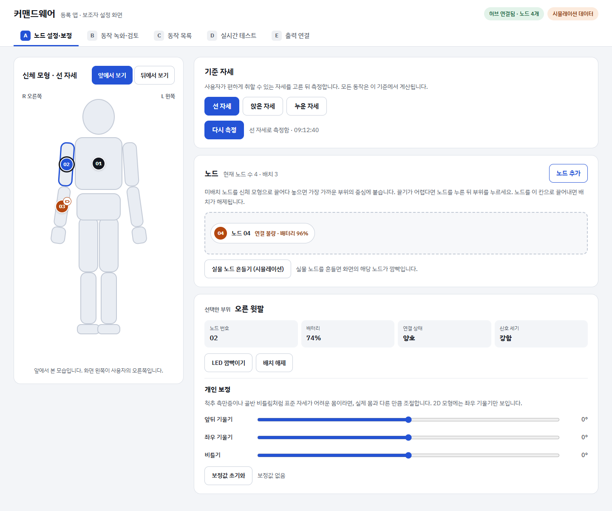
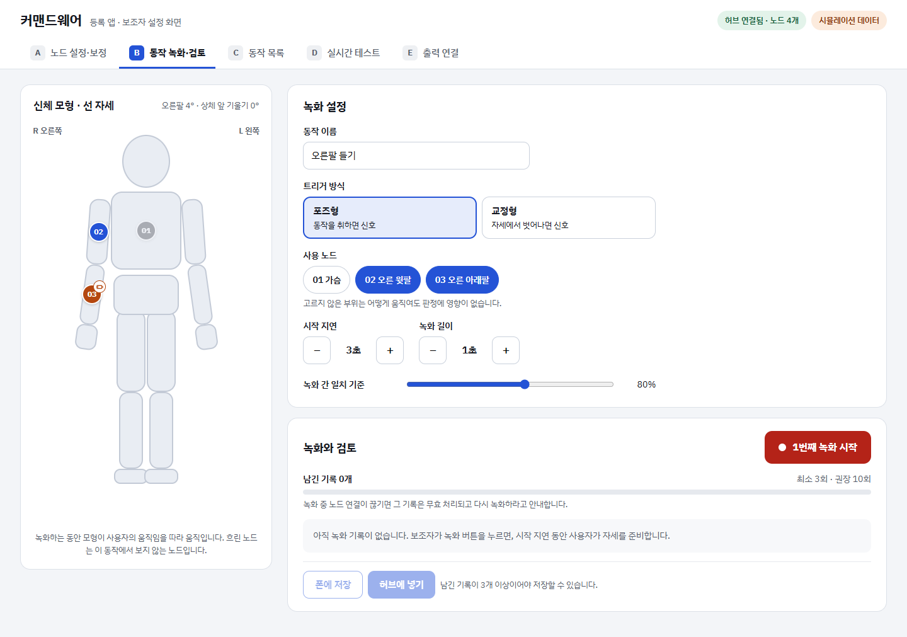
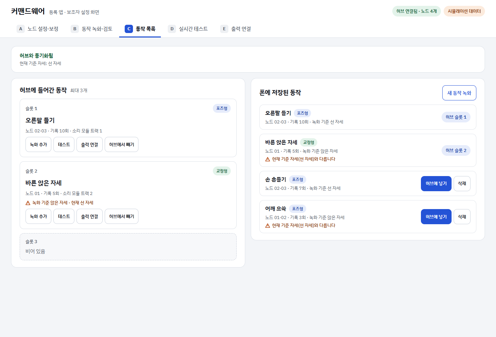
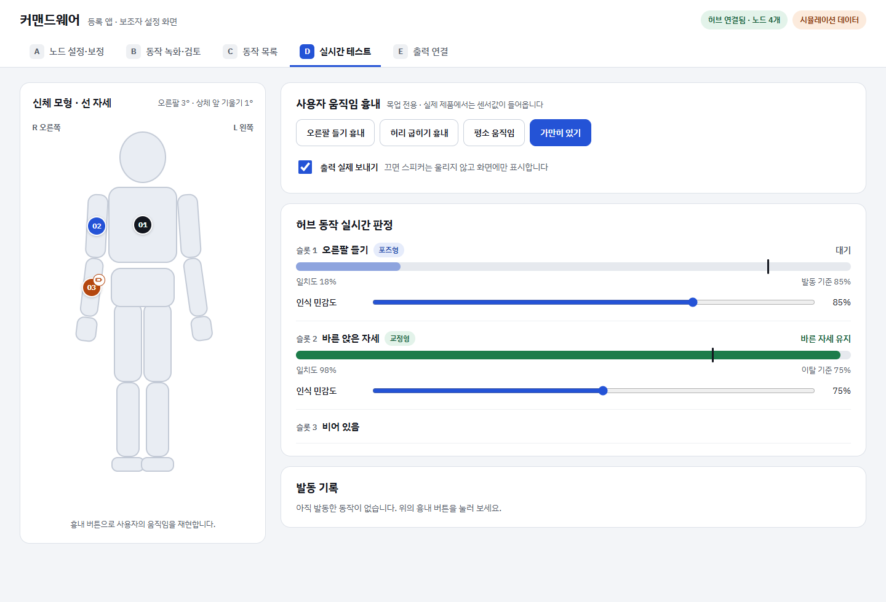

# 제안서

## 2026-2 스마트디바이스프로그래밍

- 학번: 2022111772
- 이름: 서국현

## 프로젝트명: 커맨드웨어 등록 앱 — 몸의 동작을 버튼으로 만드는 보조자용 설정 앱

### 1. 제안 배경 및 문제 정의 (Why)

**제안 배경**

스마트폰, 조명, 스피커 같은 기기는 대부분 손으로 버튼을 누르거나 화면을 터치해야 쓸 수 있다. 음성 명령이 대안이 될 수 있지만 주변이 시끄럽거나 여러 사람이 동시에 말하면 인식이 어렵다. 손을 쓰기 어려운 사람에게는 이 두 방법 모두 매일 겪는 불편이다.

**해결하고자 하는 문제**

- 손을 쓰지 않고, 소음의 영향도 받지 않으면서 기기를 조작할 방법이 부족하다.
- 기존 제스처 기기는 **정해진 동작**만 인식하므로, 그 동작을 할 수 없는 사람은 쓸 수 없다.
- 사람마다 움직일 수 있는 부위가 다른데, 센서를 붙이는 위치를 사용자가 정할 수 있는 제품이 드물다.

**객관적 근거**

- 보건복지부 등록장애인 현황(2024년 말 기준)에 따르면 등록장애인은 약 263만 명으로 인구의 5.1%이며, 이 중 **지체장애가 약 43%로 가장 많다.** 또한 65세 이상 비율이 55.3%로 높아지고 있어, 손이나 팔의 움직임이 불편한 사용자는 앞으로 더 늘어날 것으로 예상된다. [1][2]

**비슷한 서비스 조사 및 한계**

| 방식 | 손 없이 사용 | 소음에 강함 | 부착 위치 선택 | 다른 기기로 신호 전송 | 한계 |
|---|---|---|---|---|---|
| 버튼·리모컨 | X | O | X | O | 손이 필요함 |
| 음성 명령 | O | X | — | O | 소음·다중 화자에 약함 |
| 스위치 보조기기 | O | O | △ | O | 누르기 하나 = 명령 하나, 정해진 위치 |
| 스마트워치 제스처 (Apple·Galaxy) | X | O | X | △ | 손을 쥐거나 집는 고정 동작, 자사 기기 위주 |
| MiMU 장갑 | X | O | X | △ | 손에만 착용, 실행 중에도 PC 필요 [3] |
| VR 트래커 (SlimeVR 등) | O | O | O | X | 자세 추적만 하고 명령 기능 없음 [4] |
| 범용 제스처 밴드 (Myo) | X | O | X | O | 2018년 판매 종료 [5] |

**차별성**

커맨드웨어는 새로운 센서 기술을 만드는 것이 아니라, 이미 검증된 기술을 새롭게 조합한다.

1. **학습형 동작**: 사용자가 할 수 있는 동작을 직접 녹화해 명령으로 등록한다.
2. **전신 자유 부착**: IMU 노드를 몸 어디에나 원하는 개수만큼 붙인다.
3. **폰 없는 실행**: 앱은 등록할 때만 쓰고, 실제 판정은 가슴의 허브가 한다.

### 2. 과제 소개 (What)

**목적**

커맨드웨어는 몸에 붙인 IMU 노드로 동작을 인식해, 등록한 동작을 하면 다른 기기에 신호를 보내는 웨어러블 장치이다. 이번 과제에서는 그중 **안드로이드 등록 앱**을 개발한다. 보호자나 치료사(보조자)가 이 앱으로 노드를 배치하고, 사용자의 기준 자세를 측정하고, 명령으로 쓸 동작을 녹화해 허브에 넣는다.

**주요 내용**

- 신체 모형 위에 노드를 끌어다 놓아 부착 위치 등록
- 기준 자세 측정 및 개인 체형 보정 (척추 측만, 골반 비틀림 등)
- 동작 녹화: **포즈형**(동작을 취하면 신호), **교정형**(자세에서 벗어나면 신호)
- 녹화 결과 검토 후 허브 슬롯(최대 3개)에 저장
- 실시간 판정 테스트로 동작이 잘 인식되는지 확인

**주요 사용자**

- 직접 사용자: 손을 쓰기 어려운 사람 (예: 어깨 으쓱 → 조명 켜기)
- 앱 사용자: 설정을 돕는 보호자·치료사
- 확장 사용자: 공연·코스프레(포즈 → 효과음), 자세 교정(허리 굽힘 → 경고)

**활용 상황**

1. 보조자가 앱을 켜고 허브에 연결한다.
2. 사용자 몸에 노드를 붙이고, 앱의 신체 모형에 같은 위치를 표시한다.
3. 사용자가 편한 기준 자세를 취하면 측정한다.
4. 사용자가 명령으로 쓸 동작을 3~10회 반복하고, 보조자가 녹화한다.
5. 허브에 동작을 넣은 뒤에는 폰 없이, 사용자가 동작만 하면 기기가 반응한다.

### 3. 주요 기능과 구현방법 (How)

**예상 화면 구성**

> 아래는 등록 앱 목업(시뮬레이션 데이터)의 화면이다. 실제 앱은 같은 흐름을 안드로이드 화면에 맞게 나눠 구현한다.

**A. 노드 설정·보정** — 신체 모형에 노드 배치, 기준 자세 측정, 개인 보정

**B. 동작 녹화·검토** — 동작 이름·트리거 방식·사용 노드 설정, 녹화 후 검토

**C. 동작 목록** — 허브 슬롯(최대 3개)과 폰에 저장된 동작 관리

**D. 실시간 테스트** — 사용자 움직임에 대한 동작별 일치도와 발동 기록

| 화면 | 구성 |
|---|---|
| ① 연결 화면 | 허브 검색·연결, 노드 개수와 배터리 표시 |
| ② 노드 배치 | 신체 모형(앞/뒤), 미배치 노드 목록, 노드 흔들기·깜빡이기로 실물 확인 |
| ③ 기준 자세·보정 | 선/앉은/누운 자세 선택, 부위별 보정 슬라이더 |
| ④ 녹화 설정 | 동작 이름, 트리거 방식, 사용 노드, 시작 지연, 녹화 길이 |
| ⑤ 녹화와 검토 | 녹화 기록 목록, 다시 보기·남기기·버리기 (최소 3회, 권장 10회) |
| ⑥ 동작 관리 | 허브 슬롯 3개, 폰에 저장된 동작 목록 |
| ⑦ 실시간 테스트 | 일치도 표시, 인식 민감도 조절, 발동 기록 |

**주요 기능 및 구현 방법**

| 주요 기능 | 기능 설명 | 예상 구현 방법 |
|---|---|---|
| 허브 연결 | 허브를 찾아 연결하고 노드 상태를 받음 | BLE(`BluetoothLeScanner`, `BluetoothGatt`), 권한 요청 |
| 연결 유지 | 화면을 옮겨도 연결과 센서 수신 유지 | 서비스(`Service`), 브로드캐스트 리시버로 화면에 데이터 전달 (14장) |
| 화면 이동 | 단계별 화면 이동과 데이터 전달 | 액티비티와 인텐트 (10장) |
| 노드 배치 | 신체 모형의 부위를 눌러 노드 배치 | `ImageView` 위 터치 좌표로 부위 판별, 드래그 앤 드롭 |
| 기준 자세·보정 | 기준 자세 측정, 부위별 보정값 저장 | IMU 쿼터니언 평균, `SeekBar` |
| 동작 녹화 | 시작 지연 후 정해진 시간 동안 센서값 기록 | `CountDownTimer`, 센서 데이터 버퍼 |
| 녹화 검토·동작 목록 | 녹화 기록과 저장된 동작을 목록으로 표시 | 리스트뷰와 어댑터 (11장) |
| 동작 저장 | 동작 이름, 방식, 노드, 녹화 데이터를 폰에 저장 | SQLite 데이터베이스 (12장) |
| 허브에 넣기 | 선택한 동작을 허브 슬롯에 전송 | BLE 쓰기(`writeCharacteristic`) |
| 실시간 테스트 | 현재 동작과 등록 동작의 일치도 표시 | 각도 차이 기반 일치도 계산, `ProgressBar` |
| 시뮬레이션 모드 | 실물 없이 앱 기능을 시연 | 미리 만든 센서 데이터 재생, 폰 내장 가속도 센서(`SensorManager`)를 노드 1개로 사용 |

### 4. 기대 효과 및 최종 결과물 (Result)

**기대 효과**

- 손을 쓰기 어려운 사람이 **자신이 할 수 있는 동작**으로 기기를 조작할 수 있다.
- 보조자가 전문 지식 없이도 화면 안내에 따라 동작을 등록할 수 있다.
- 공연 연출, 자세 교정 등 다른 분야로 확장할 수 있다.

**최종 결과물 (구현 범위)**

| 구분 | 내용 |
|---|---|
| 필수 구현 | ①~⑦ 화면, SQLite 동작 저장, 시뮬레이션 모드에서 녹화부터 실시간 테스트까지 전체 흐름 |
| 추가 구현 | 실제 허브와 BLE 연결, 허브 슬롯 전송 |
| 다음 단계 | 출력 연결 화면 (소리 모듈 트랙, 모터, 조명, 블루투스 키 입력) |

- GitHub 저장소의 소스 코드, 시연 영상, 최종 보고서

### 5. 개발 일정

| 기간 | 주요 작업 | 결과물 |
|---|---|---|
| 2026.11.05 | 프로젝트 제안 | 제안서 |
| 2026.11.12 | 개발 시작: 화면 구성, 액티비티·인텐트 화면 이동 | 초기 소스 코드 |
| 2026.11.19 | 주요 기능 개발: 노드 배치, 녹화, 리스트뷰, SQLite 저장 | 중간 결과물 |
| 2026.11.26 | 실시간 테스트, 시뮬레이션 모드, 서비스·BLE 연결 | 기능 구현 완료본 |
| 2026.12.03 | 테스트 및 디버깅 | 테스트 결과 |
| 2026.12.08 | 프로젝트 마무리 | 최종 결과물 및 보고서 |

### 6. 참고 자료

1. 보건복지부, 「2024년도 등록장애인 현황」, KOSIS 국가통계포털. https://kosis.kr
2. 세계일보, 등록장애인 현황 보도 (2025.04.23). https://segye.com/newsView/20250423526770
3. MiMU Gloves 소개 영상, YouTube. https://www.youtube.com/watch?v=CvyVQqCO8pY
4. VR 트래커(SlimeVR) 소개 영상, YouTube. https://www.youtube.com/watch?v=2JqAj1_KYXU
5. VentureBeat, "Amazon-backed wearables company Thalmic Labs kills its Myo armband". https://venturebeat.com/ai/amazon-backed-wearables-company-thalmic-labs-kills-its-myo-armband-teases-new-product
